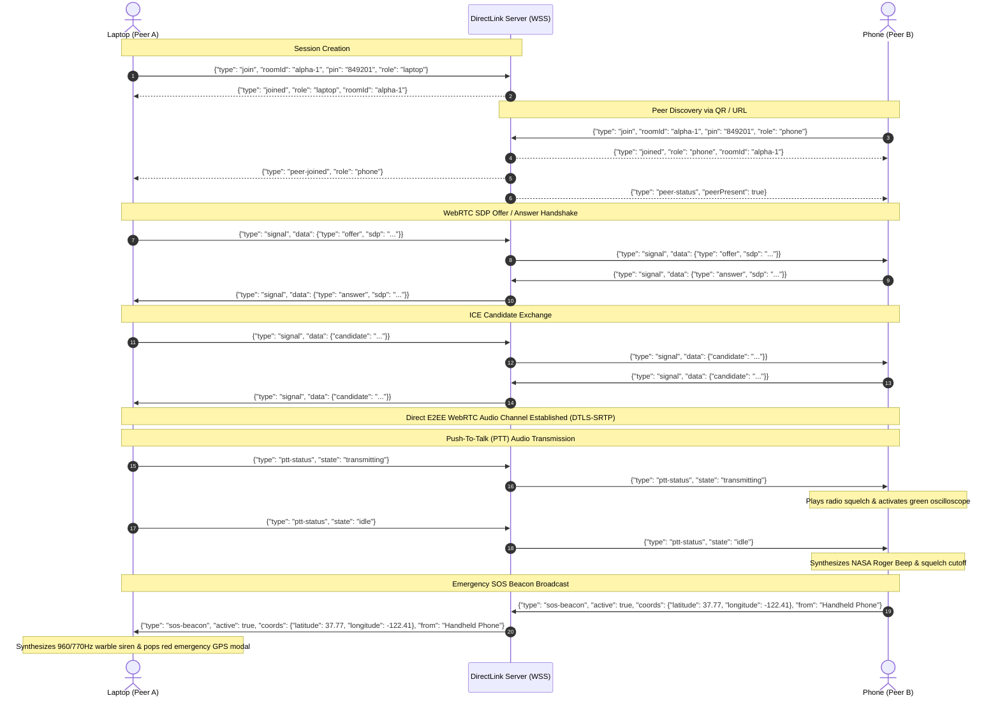

# Signaling Protocol & REST API Specification 📡

DirectLink employs a bi-directional WebSocket protocol for session orchestration, WebRTC peer connection handshakes, and Push-To-Talk (PTT) state synchronization.

---

## 📡 WebSocket Signaling Lifecycle



---

## 📨 WebSocket Message Schema

### 1. Client to Server Messages

#### Join Channel (`join`)
Sent immediately when a client connects to claim or enter a tactical channel.
```json
{
  "type": "join",
  "roomId": "tactical-room-123",
  "pin": "654321",
  "role": "laptop",
  "deviceName": "ThinkPad-X1"
}
```

#### WebRTC Signaling Envelope (`signal`)
Wraps SDP offers, answers, and ICE candidate objects.
```json
{
  "type": "signal",
  "data": {
    "type": "offer",
    "sdp": "v=0\r\no=- ..."
  }
}
```

#### Push-to-Talk State Update (`ptt-status`)
Notifies the peer whether the microphone audio gate is active or idle.
```json
{
  "type": "ptt-status",
  "state": "transmitting" // or "idle"
}
```

#### Emergency SOS Beacon (`sos-beacon`)
Transmits high-priority emergency alerts and GPS coordinates to the peer.
```json
{
  "type": "sos-beacon",
  "active": true,
  "coords": {
    "latitude": 37.774929,
    "longitude": -122.419416,
    "accuracy": 14.2
  },
  "from": "Handheld Phone",
  "timestamp": 1700000000000
}
```

---

### 2. Server to Client Messages

#### Join Confirmation (`joined`)
Confirms successful channel entry.
```json
{
  "type": "joined",
  "role": "laptop",
  "roomId": "tactical-room-123"
}
```

#### Peer Arrival Notification (`peer-joined`)
Alerts an existing peer that the second device has connected.
```json
{
  "type": "peer-joined",
  "role": "phone",
  "deviceName": "Pixel 9 Pro"
}
```

#### Peer Departure Notification (`peer-left`)
Emitted when a peer disconnects or closes their browser tab.
```json
{
  "type": "peer-left",
  "role": "phone"
}
```

#### Protocol Error (`error`)
Emitted when authentication fails, room is full, or malformed data is received.
```json
{
  "type": "error",
  "message": "Invalid PIN for this channel"
}
```

#### Emergency SOS Beacon Relay (`sos-beacon`)
Forwarded immediately to the other peer in the bonded channel when an emergency beacon is triggered or cancelled.
```json
{
  "type": "sos-beacon",
  "active": true,
  "coords": {
    "latitude": 37.774929,
    "longitude": -122.419416,
    "accuracy": 14.2
  },
  "from": "Handheld Phone",
  "timestamp": 1700000000000
}
```

---

## 🌐 REST API Endpoints

### `GET /api/info`
Returns server networking status, active ports, discovered local IPv4 interfaces, and active WAN tunnel information.

**Response:**
```json
{
  "httpsPort": 8443,
  "httpPort": 8080,
  "localIps": [
    { "name": "Wi-Fi", "ip": "192.168.0.142" }
  ],
  "tunnelUrl": "https://brave-frog-22.loca.lt",
  "isTunneling": true,
  "activeRooms": 1
}
```

---

### `GET /api/qr?text=<URL>`
Generates a tactical green SVG QR Code on the fly for phone scanning.

* **Query Parameters:**
  * `text` *(string, required)*: The target pairing URL.
* **Response:**
  * `Content-Type: image/svg+xml`

---

### `POST /api/tunnel`
Dynamically provisions or tears down a secure WAN tunnel for cellular connectivity.

**Request Body:**
```json
{
  "enable": true,
  "subdomain": "directlink-private"
}
```

**Response:**
```json
{
  "success": true,
  "tunnelUrl": "https://directlink-private.loca.lt"
}
```
